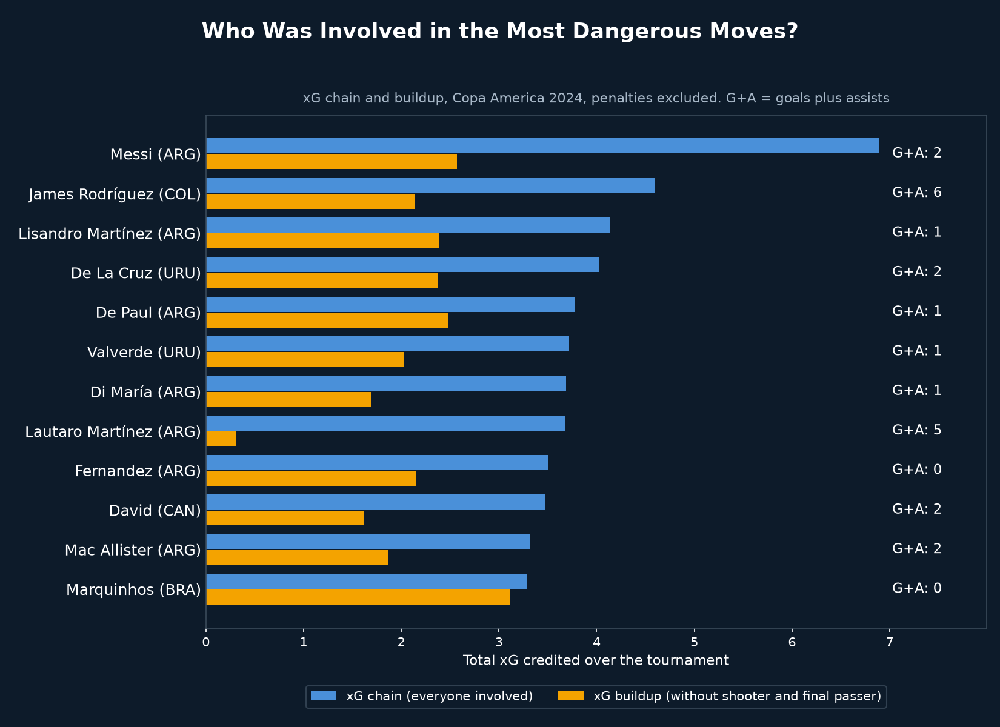
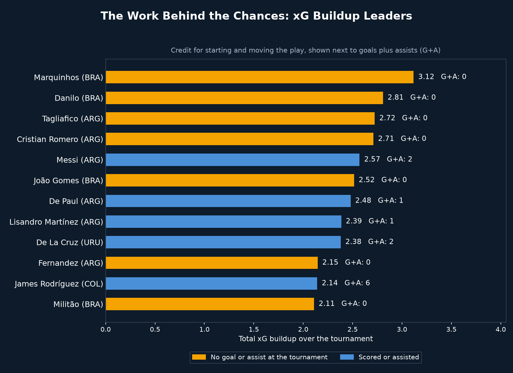
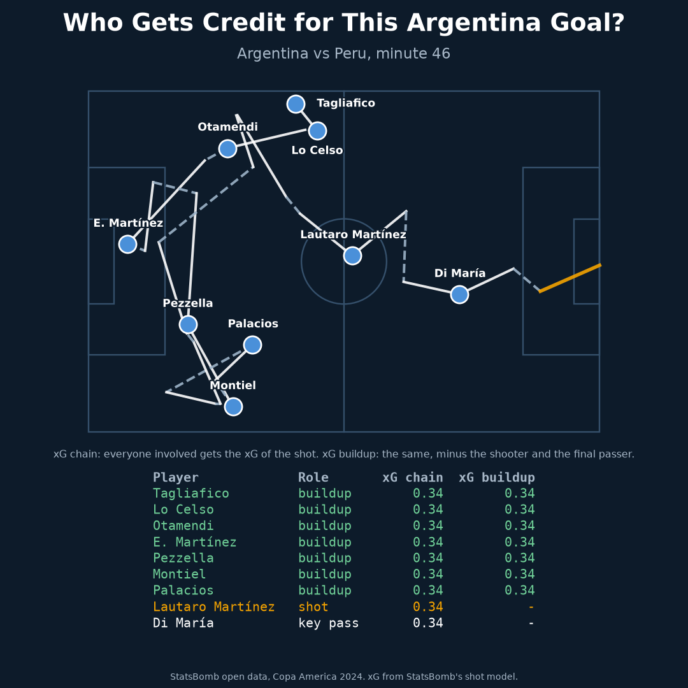

# xG Chain and Buildup Leaderboard: Copa America 2024

## Why
Goals and assists credit only the last two touches of a move. Earlier in this series, a simulation that removed Messi's goals and assists barely changed Argentina's results, because he scored or assisted in only 2 of 6 matches. The model was blind to everything else he did. This project replaces that measure with two that share the credit across the whole move.

## What it does
- Uses StatsBomb open event data for all 32 Copa America 2024 matches, extra time included, shootouts and penalties excluded
- Finds the 679 possessions that ended in a non-penalty shot
- xG chain: every player who passed, carried, dribbled or shot in that possession gets the possession's xG
- xG buildup: the same, but the shooter and the player who made the final pass get nothing, so it shows who started and moved the play
- Compares both against goals plus assists, and replays one real Argentina goal move

## Key findings
Top 5 by xG chain:

| Player | xG chain | xG buildup | Goals + assists |
|---|---|---|---|
| Messi (ARG) | 6.89 | 2.57 | 2 |
| James Rodríguez (COL) | 4.60 | 2.14 | 6 |
| Lisandro Martínez (ARG) | 4.13 | 2.39 | 1 |
| De Paul (ARG) | 3.78 | 2.48 | 1 |
| Lautaro Martínez (ARG) | 3.68 | 0.31 | 5 |

Top 4 by xG buildup:

| Player | xG buildup | xG chain | Goals + assists |
|---|---|---|---|
| Marquinhos (BRA) | 3.12 | 3.28 | 0 |
| Danilo (BRA) | 2.81 | 3.06 | 0 |
| Tagliafico (ARG) | 2.72 | 3.04 | 0 |
| Romero (ARG) | 2.71 | 3.06 | 0 |

- Messi has the highest xG chain by a wide margin (6.89 against 4.60 for the next player), with 1 goal and 1 assist. A goals-and-assists count saw 2 contributions, while xG chain shows him involved in 39 shot-ending moves
- 7 of the 12 highest xG buildup players had no goal or assist at the tournament
- Lautaro Martínez scored 5 goals but has an xG buildup of only 0.31, so almost all of his credit comes from finishing
- In the replayed goal (Argentina against Peru, 46th minute, 9 players, 33 actions, xG 0.34), goals and assists credit 2 of the 9 players. The other 7 earn buildup credit, including the goalkeeper

## Limitations
- Totals, not per 90, because lineup data was not pulled. Teams that played more matches have more chances to collect credit (Argentina played 6, Brazil 4)
- Every touch counts the same. A safe pass back and the pass that breaks the lines earn identical credit, so this measures involvement, not how much each touch mattered
- Credit adds up to more than the tournament's total xG, because one chance credits many players
- Defensive actions that win the ball are not credited unless the player then passes, carries or shoots
- xG comes from StatsBomb's shot model and says nothing about the quality of earlier passes
- A possession's value is the summed xG of its shots, so rebounds count toward the same move

## Visual

*Top 12 by xG chain, with xG buildup beside it and goals plus assists on the right*

*Top 12 by xG buildup. Orange bars are players with no goal or assist at the tournament*

*Who earns which credit in one real goal move*

`goal_move_replay.mp4` in this folder replays that move: the ball travels through every player involved, then the credit is shared out.

## Tools
Python, pandas, numpy, matplotlib, imageio-ffmpeg, statsbombpy

## Data source
StatsBomb open data (via `statsbombpy`), Copa America 2024, competition_id 223, season_id 282
